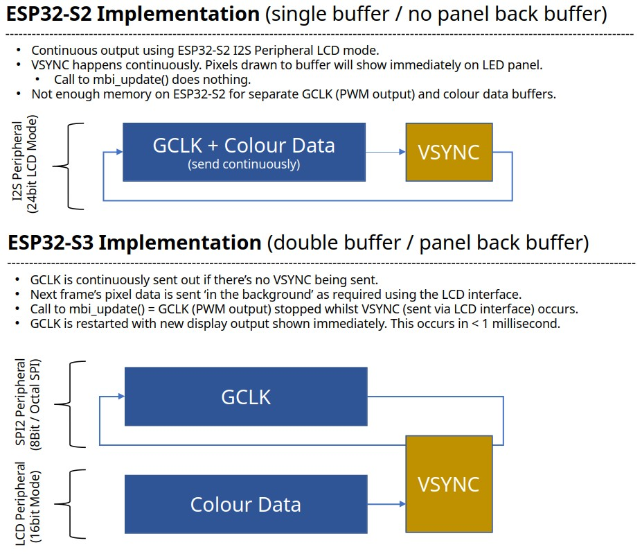

## Using a 78 x 78 pixel MBI5153 based PWM LED MatrixPanel with a ESP32-S2 or S3.

Uses PWM based chip that takes 16 bits sent in a series for every pixel in the relevant chain.

More info on the panels here: https://led.limehouselabs.org/docs/tiles/dmg1083/

## Software and Hardware implementation(s)
There are two hardware implementations for this LED panel, as one implementation isn't enough for me. As these two Espressif MCU’s have different capabilities and constraints, the software implementations are different. 

tl/dr - The ESP32-S3 is the best device to use of the two implementations. However, the ESP32-S2 is super cheap to buy and does the job depending on your needs. 

### ESP32-S2: I2S LCD mode, 24-bit parallel DMA

The [`esp32s2_i2s_24bit_dma_platformio`](esp32s2_i2s_24bit_dma_platformio/) implementation turns the S2's I2S peripheral into a parallel signal engine by using its LCD mode. A circular DMA buffer contains successive 24-bit GPIO states: the 12 colour data lanes plus DCLK, LAT, GCLK, and row-address signals. Once set up, I2S and DMA continuously replay the stream; software prepares pixel values in that buffer rather than bit-banging every edge. The buffer can be placed in internal SRAM or PSRAM, with the expected trade-off in available capacity and achievable clock rate.

This is a wonderfully audacious use of a peripheral most people associate with audio: one I2S stream becomes a complete, carefully timed panel-refresh machine. It is also a relatively compact way to make an inexpensive ESP32-S2 do a surprising amount of work.

### ESP32-S3: LCD_CAM/GDMA for pixels, GPSPI2 DMA for scan timing

The [`esp32s3_gdma_lcd_gspi2_dma_platformio`](esp32s3_gdma_lcd_gspi2_dma_platformio/) implementation gives the two jobs to different S3 peripherals. LCD_CAM, fed by GDMA, shifts packed 16-bit grayscale pixel data and latch signals across the parallel outputs. GPSPI2, using an octal-mode segmented DMA loop, generates the repeating GCLK and row-address stream. At a frame boundary the scan stream is stopped, a separate transfer produces the MBI Vsync/latch sequence, and the scan stream is restarted. The CPU prepares image data and coordinates the frame update while the peripherals handle the repetitive, timing-sensitive traffic.

This is an even more elaborate and frankly brilliant bit of peripheral choreography: LCD_CAM and SPI are being pressed into service as deterministic signal generators, with DMA doing the heavy lifting. The S3 implementation is more capable, but its GPSPI2 path also leans on private ESP-IDF internals, so it is more version-sensitive than a tidy public-API library would be.

Both approaches are technically delightful solutions to a very specific hardware puzzle. They are also, in the grand scheme of things, gloriously irrelevant: these are junk panels. There is no sensible product roadmap hiding here—just an unreasonable amount of engineering spent making dubious panels display pixels properly. Consider the implementations experiments and demonstrations of what the ESP32 peripherals can do, not general-purpose drivers or an argument for buying these panels.
